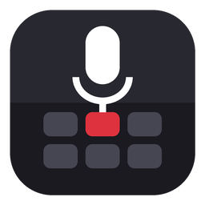
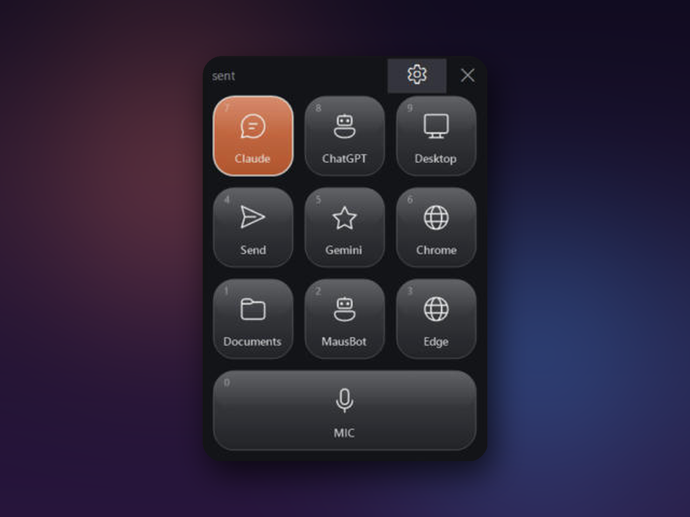
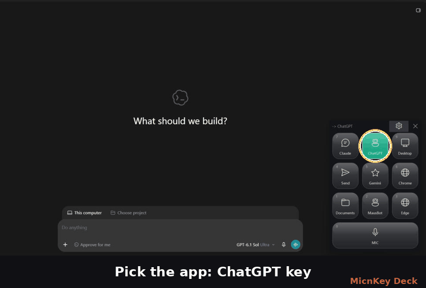

  

<h1 align="center">MicnKey Deck</h1>

  <b>A floating mic + shortcut keypad for Windows that talks to Claude, ChatGPT and Gemini.</b> 
  Press one key to start the AI app's <i>own</i> dictation, press again to stop, press Send — no mouse hunting.

  
  
  

  Free &amp; open source · No admin rights · No installs besides this · Runs 100% locally

  

The deck floating over a Claude window: the key of the app you're in lights up in its own colour.

  

MIC → speak → Send. The pad presses the app's own mic, then stops it and sends in one tap.

---

## Mic + Key = MicnKey

Talking to an AI is faster than typing it. The hard part is everything *around* the talking: finding the tiny mic icon, clicking it, waiting, clicking stop, clicking back into the box, pressing Enter, switching to the other app…

**MicnKey** is named after the two things it gives you:

- 🎙️ **Mic** – one big MIC key that presses the AI app's *own* dictation button (the good one, not Windows voice typing), shows you when it's really listening, and stops it when you're done.
- ⌨️ **Key** – the handful of keys you actually press all day: open Claude / ChatGPT / Gemini, **Send**, show the desktop, jump to your browser or a folder.

**Deck** because it sits on your screen like a small hardware macro pad, the kind of AI voice keypad people buy as a gadget, except it's free, lives in software, and you can redesign it in a minute. Click it with the mouse, tap it on a touchscreen, or turn your **number pad** into the same layout (7-8-9 / 4-5-6 / 1-2-3 / 0) and put stickers on the keys.

## Why

Claude, ChatGPT and Gemini have excellent built-in dictation, but on Windows you have to find and click a tiny mic icon every time. MicnKey Deck gives you a big **MIC** key (on screen, on your number pad, or a keyboard shortcut) that presses that button for you, shows you when the mic is really listening, and sends the message when you're done.

## Features

- **Smart MIC key** — presses the app's own dictation button (Claude, ChatGPT, Gemini). The key shows the real state:
  🟡 Connecting → 🔴 **SPEAK NOW** → 🔵 Transcribing → 🟢 Draft ready.
- **Send while talking** — press Send and it stops the mic, waits for the text, then sends.
- **Works in any app language** — finds the mic button by name, by internal id or by its position; you can also *teach* it (right-click MIC).
- **App keys that switch, not duplicate** — Claude / ChatGPT / Gemini / Chrome / Edge / folder keys jump to the window that is already open, and the key of the app you're in lights up.
- **Number pad as AI keys** — press **Insert** (or double-click the pad's title strip) and your number pad becomes the deck; press Insert again to get numbers back. The small number on each key is its number-pad key, and the title strip reminds you how to switch, so nobody needs to read a manual (stickers welcome).
- **Never steals focus** — clicking the pad keeps your cursor where it was.
- **Always findable** — stays on top, comes back after Show desktop, and **Ctrl+Alt+P** calls it back from anywhere. Top-right: **–** hides the pad (it keeps running), **×** quits it.
- **Point-and-click settings** — add, remove and reorder keys, pick icons and colours, set shortcuts. English and Vietnamese.
- **Private** — runs locally, no network calls, no telemetry.

## Install (2 minutes)

1. **Download** the latest `MicnKey-Deck-vX.Y.zip` from **[Releases](../../releases)**.
2. **Right-click the zip → Properties → tick _Unblock_ → OK** (this avoids Windows warnings), then **Extract All**.
3. **Double-click `Install.cmd`.**

That's it — the pad appears at the bottom-right, and a **MicnKey Deck** shortcut is added to your Desktop and Start menu.

> If Windows shows *"Windows protected your PC"*, click **More info → Run anyway**. The app is a set of readable PowerShell scripts; you can inspect every line in the `app` folder.

**Don't want to install?** Open the `app` folder and double-click `Start-MicnKey.cmd`.

## Default layout

The pad mirrors the number pad, so the keys match when **AI keys mode** (Insert) is on:

| | | |
|:-:|:-:|:-:|
| **7** Claude | **8** ChatGPT | **9** Show desktop |
| **4** Send | **5** Gemini | **6** Chrome |
| **1** Documents | **2** Downloads | **3** Edge |
| **0** MIC (wide) | | |

Keyboard shortcuts: **Ctrl+Alt+M** mic · **Ctrl+Alt+C** Claude · **Ctrl+Alt+O** ChatGPT · **Insert** AI keys on/off.

If an AI desktop app isn't installed, its key opens the website instead.

## Using the MIC key

1. Open Claude, ChatGPT or Gemini (or just press MIC — it jumps to the AI app you used last).
2. Press **MIC** → wait for red **SPEAK NOW** → talk.
3. Press **MIC** again to stop — the text lands in the chat box so you can edit it. Or press **Send** to stop *and* send.

**MIC doesn't find the button?** (e.g. the app is in another language or got redesigned)
Right-click the **MIC** key → hover over the app's mic button for 5 seconds → then start dictation in the app and hover over its stop button. Done — it's remembered in `mic-learned.json`.

## Customize

Click the **gear** on the pad (or Start menu → *MicnKey Deck Settings*):

- **+ Add key** / **Delete key** / **Move up/down**
- **What it does:** open a folder · open a file, app or website · paste saved text (a prompt) · press keys (Enter, Ctrl+C…) · open/switch to an app · smart microphone · show desktop
- **Icon, colour, keyboard shortcut** (e.g. F9 or Ctrl+Alt+D), **number-pad key**
- **General:** opacity, key size, columns, start with Windows, AI-keys toggle key, language

Click **Save** — the pad reloads in about a second. Power users can edit `config.json` directly (see [CONTRIBUTING.md](CONTRIBUTING.md) for the format).

## Requirements

- Windows 10 or 11 (uses the built-in Windows PowerShell 5.1 and .NET — nothing else to install)
- A microphone, with *Settings → Privacy → Microphone → Let desktop apps access your microphone* turned on
- Optional: Claude, ChatGPT and/or Gemini desktop apps

## Troubleshooting

| Problem | Fix |
|---|---|
| Nothing happens after Install | Unblock the zip (step 2) and run `Install.cmd` again. Work/school PCs may block PowerShell scripts entirely. |
| I can't see the pad any more | Press **Ctrl+Alt+P** – it comes back on top (and to the bottom-right corner if it was off screen). If nothing happens, the pad was quit with **×** (not hidden with **–**): open **MicnKey Deck** from the Start menu or desktop. If that hotkey is used by another app, the pad picks Ctrl+Alt+Space instead (see `micnkey.log`). |
| The pad takes a while to appear the first time | Normal: the first start can take 30–60 seconds while Windows/antivirus scans the new files. Later starts are faster. |
| Need to see errors | Run `Debug-MicnKey.cmd` in the install folder (`%LOCALAPPDATA%\MicnKey Deck`) – it keeps a console open. The log is `micnkey.log` in the same folder. |
| Antivirus warning | The app simulates key presses in other apps, which some antivirus tools flag. Review the scripts and allow the folder `%LOCALAPPDATA%\MicnKey Deck`. |
| MIC says "right-click MIC to teach me" | Use the teach steps above. |
| Number pad keys type numbers | Press **Insert** (title bar turns green) and make sure **NumLock** is on. |
| A shortcut key doesn't work | Another app already uses it — pick a different one in Settings. |
| Anything else | Check `%LOCALAPPDATA%\MicnKey Deck\micnkey.log` and open an issue with the last lines. |

## Uninstall

Double-click `Uninstall.cmd` from the zip (or delete `%LOCALAPPDATA%\MicnKey Deck` and the shortcuts).

## How it works

Plain PowerShell + WinForms, no dependencies:

- **Windows UI Automation** reads the buttons inside Claude/ChatGPT/Gemini (their accessibility tree) and presses the dictation button directly.
- **Windows Core Audio** tells the pad which app actually has the microphone open — that's what drives the live mic colours.
- A **no-activate window** (like the Windows on-screen keyboard) keeps focus in your app.

## Contributing

Ideas, bug reports and pull requests are very welcome — especially **mic-button names in other languages** and support for more AI apps. See **[CONTRIBUTING.md](CONTRIBUTING.md)**.

If MicnKey Deck saves you clicks, a ⭐ on GitHub helps others find it.

## License

[MIT](LICENSE). MicnKey Deck is an independent project and is not affiliated with Anthropic, OpenAI or Google. Claude, ChatGPT and Gemini are trademarks of their respective owners.
