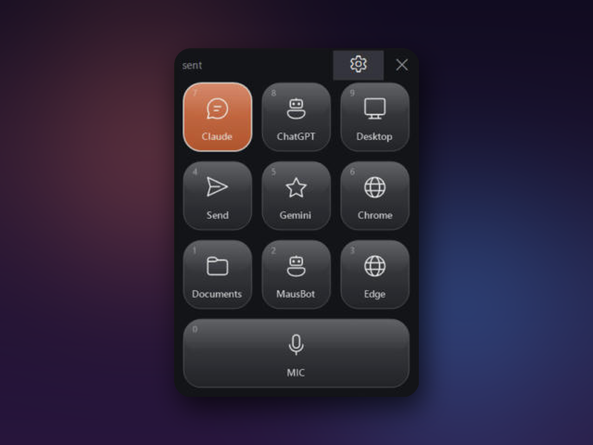

# MicnKey Deck – Hướng dẫn tiếng Việt

Bàn phím nổi trên màn hình Windows: bấm 1 phím để bật micro có sẵn của Claude / ChatGPT / Gemini, bấm lại để dừng, bấm Send để gửi.

**Vì sao tên là MicnKey?** Mic + Key: một phím **Mic** to bấm đúng nút micro xịn của app AI (không phải Win+H), và mấy **Key** quan trọng bạn bấm cả ngày: mở Claude / ChatGPT / Gemini, Send, ra Desktop, mở trình duyệt hay thư mục. **Deck** vì nó nằm trên màn hình như một bàn phím macro nhỏ; dùng chuột, chạm màn hình, hoặc biến bàn phím số (numpad) thành đúng bố cục đó.

## Cài đặt
1. Tải file `MicnKey-Deck-vX.Y.zip` ở mục **Releases**.
2. Chuột phải file zip → **Properties** → tích **Unblock** → OK, rồi **Extract All**.
3. Double-click **Install.cmd**. Xong: pad hiện ở góc dưới bên phải, có shortcut **MicnKey Deck** trên Desktop và Start menu.

Nếu Windows hiện "Windows protected your PC": bấm **More info → Run anyway**.

## Dùng micro
- Bấm **MIC**: vàng = đang kết nối, **đỏ = nói đi**.
- Bấm **MIC** lần nữa: dừng, chữ nằm sẵn trong ô chat để sửa (xanh dương = đang chép lời, xanh lá = xong).
- Bấm **Send** khi đang nói: dừng micro và gửi luôn.
- App đang để tiếng Việt mà MIC không tìm thấy nút: **chuột phải phím MIC**, rê chuột lên nút micro của app 5 giây, rồi bật đọc chính tả trong app và rê lên nút dừng. Pad sẽ nhớ.

## Bàn phím số = phím AI
Bấm **Insert** (thanh tiêu đề chuyển xanh) để bàn phím số thành các phím của pad, bấm Insert lần nữa để trở lại gõ số. Cần bật **NumLock**.

| | | |
|:-:|:-:|:-:|
| 7 Claude | 8 ChatGPT | 9 Desktop |
| 4 Send | 5 Gemini | 6 Chrome |
| 1 Documents | 2 Downloads | 3 Edge |
| 0 MIC | | |

## Tùy chỉnh
Bấm **bánh răng** trên pad → chọn phím → đổi chữ, biểu tượng, màu, việc phím làm, phím tắt, phím số → **Save**. Trong **General → Language** chọn **Tiếng Việt** để cửa sổ cài đặt hiện tiếng Việt.

## Gỡ cài đặt
Double-click **Uninstall.cmd** trong file zip.

## Không thấy pad đâu?
Bấm **Ctrl+Alt+P**, pad sẽ hiện lại trên cùng (và về góc dưới bên phải nếu đang nằm ngoài màn hình). Góc trên bên phải: nút **–** để ẩn pad (pad vẫn chạy), nút **×** để tắt hẳn. Nếu bấm Ctrl+Alt+P không có gì xảy ra thì pad đã bị tắt bằng ×: mở lại **MicnKey Deck** từ Start menu hoặc Desktop.
